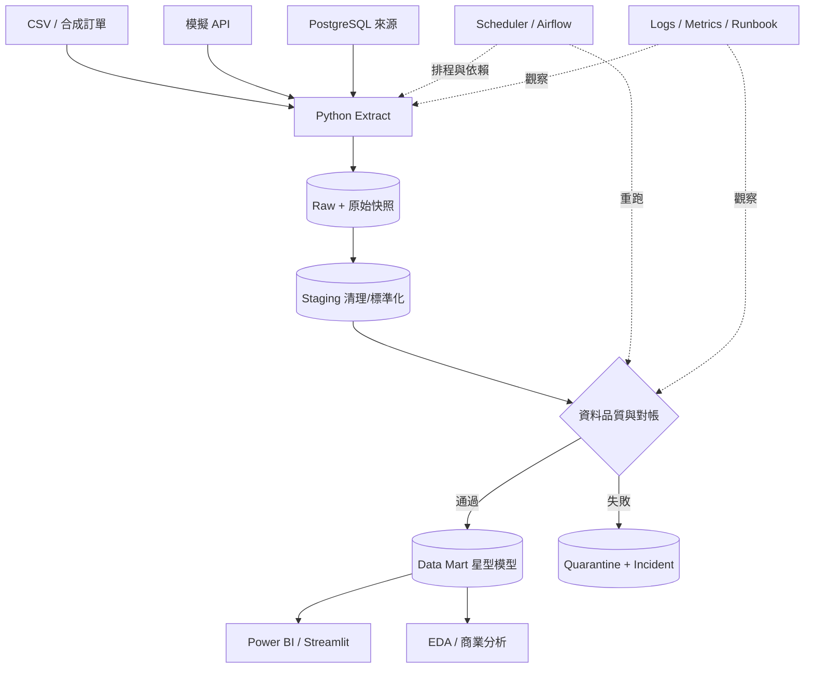

# 05｜目標架構、資料契約與設計決策

## 漸進架構，禁止第一天全部搭好

- **P01**：只做 CSV → CLI → 清理 CSV，保留原 Streamlit。
- **P02**：引入 PostgreSQL，設計 Schema / Primary Key / Constraints。
- **P03**：Raw/Staging/Mart 和增量，採用合成資料集新增 source ID。
- **P04**：Run ID、Checksum、Quarantine、對帳、原子提交、回補。
- **P05**：用 dbt 管 SQL 轉換，用 Airflow（或學習資源不足時 Cron 作對照）協調工作。
- **P06**：Compose + CI；選修低成本 Cloud Job。不要為了部署而暴露公開資料庫。
- **P07–P10**：同一份 Mart 服務分析、BI 與實驗；數字必須對得起來。
- **P11–P12**：成本/效能、演練與交接。

## 資料層級與不變條件

| 層級 | 主要職責 | 不變條件 |
|---|---|---|
| Raw | 來源快照，包含 source、ingested_at、checksum、run_id | 不就地覆蓋來源快照；原始可追溯 |
| Staging | 型別與格式統一、錯誤隔離、去重 | 規則明確可測，不靜默吞資料 |
| Mart | 具業務口徑的事實表、維度表 | 粒度與指標定義可說明、可對帳 |
| Consumption | BI/EDA/SQL 消費 | 不暗中重新定義同名 KPI |

### 身分與時間設計

現有員工資料沒有穩定 `employee_id`，不能拿姓名或列號當跨日主鍵。可用來源檔 SHA + 原始列順序描述某次匯入快照；到了電商資料，應額外產生穩定的 `order_id`、`order_line_id`、`customer_id`、`product_id`，且明確描述同筆更新版本。

訂單必須至少區分：`ordered_at`（事件時間）、`updated_at`（來源版本時間）、`ingested_at`（系統取得時間）；統一 UTC 儲存／明示台灣時區顯示，明確處理跨日與退款歸屬。

### Incremental 與 Idempotency

- 定義 Key、來源版本或遞增位置；僅 `updated_at > max(updated_at)` 可能漏掉相同 timestamp 的事件，需含 tie-breaker、適當 overlap 或 CDC 等選項。
- 應能重跑相同範圍且輸出相同結果；操作基礎是資料庫唯一約束、UPSERT、受控 transaction、批次狀態及業務鍵。
- Atomicity 與分布式 exactly-once 不可混為一談；跨系統副作用需明確拆分與對帳。
- 來源修改或晚到資料必須有 Backfill 策略，不能默默更動已發布 KPI 而不留版本。

## 資料品質最小契約

參見 [DATA-CONTRACT 模板](templates/DATA-CONTRACT.md)：字段、型別、可空、唯一鍵、允許值、事件時間、分數/金額含義、來源和更新頻率。品質至少包含 schema、null、unique、referential integrity、freshness、range、volume 與 reconciliation。失敗策略應明確是 Reject、Quarantine、Warn 還是 Retry。

## 核心業務指標示例

- `gross_order_amount`：成功建立訂單的商品行金額總和（需註明排除取消與否）。
- `paid_amount`：成功付款交易加總（需考慮分期/部分付款）。
- `refund_amount`：已完成退款金額加總（事件發生日或原始訂單日須決定）。
- `net_paid_revenue`：針對已收款且已完成退款的定義，一般可先採 `paid_amount - refund_amount` 作**教學口徑**，但不等同正式財報營收認列。

不得把單純訂單金額叫「公司營收」；必須定義稅、運費、折扣、取消、退款與認列時間。

## 架構審查的五個問題

1. 這個元件是為了解決目前已出現的問題，還是只為了履歷好看？
2. 移除 Airflow/dbt/Spark 能不能用更小成本達成相同要求？若能，差異是什麼？
3. 重跑與失敗後的正確性怎麼證明？
4. 給其他人接手，需要哪三份文件才能自行操作？
5. 資料是否公開可用，是否可能在 Log、截圖或 Dashboard 洩漏？
